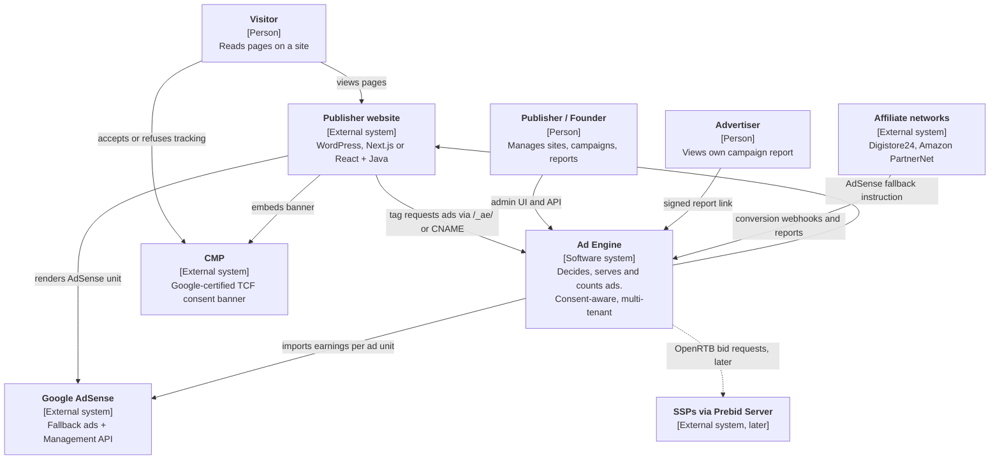
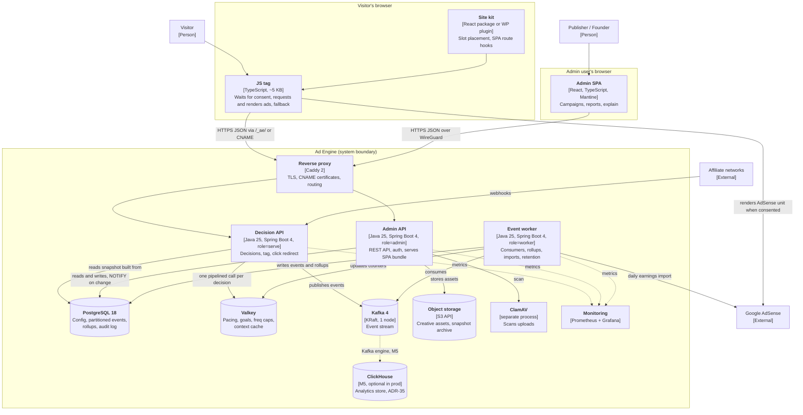
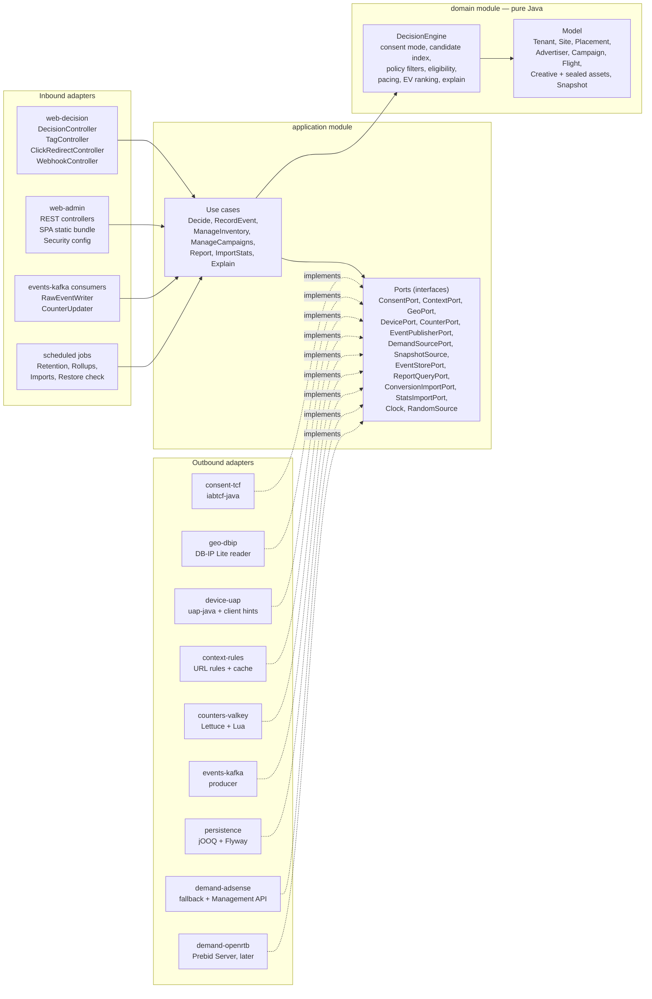
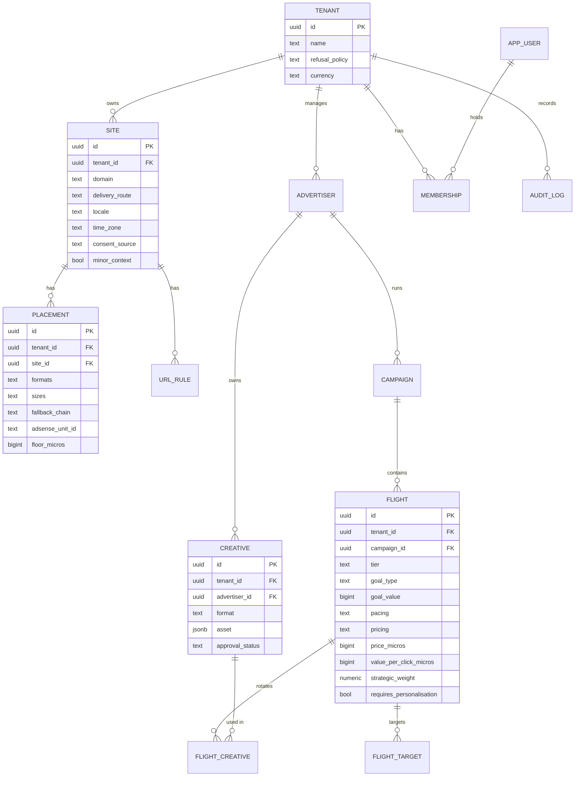
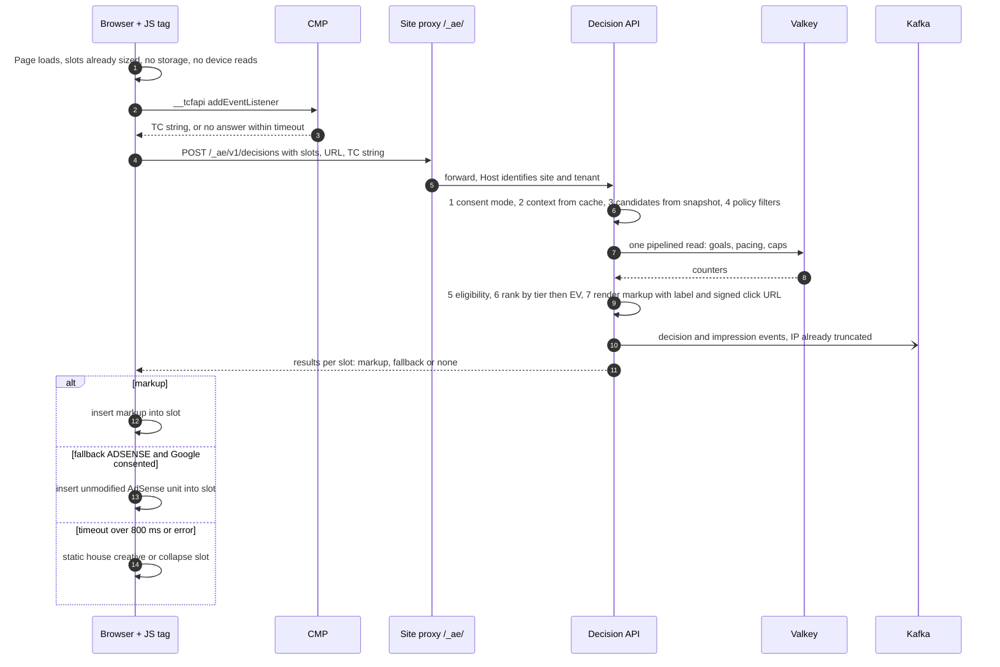
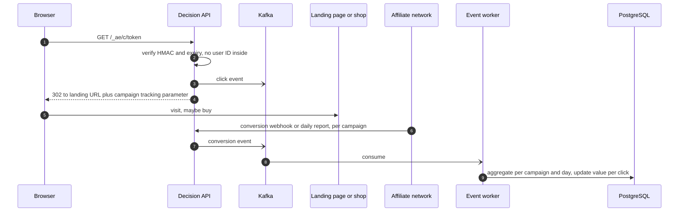
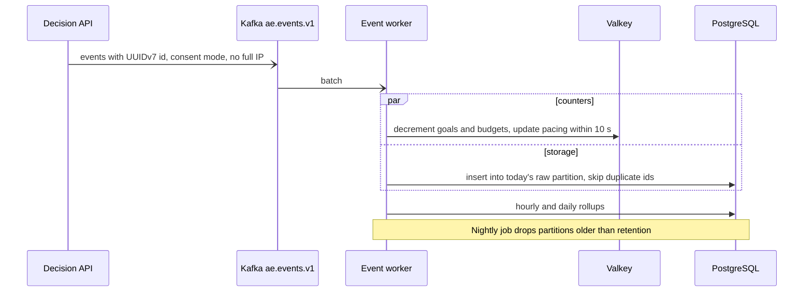
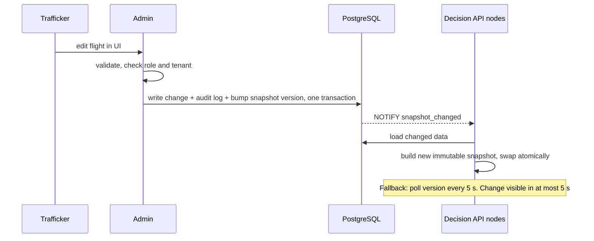
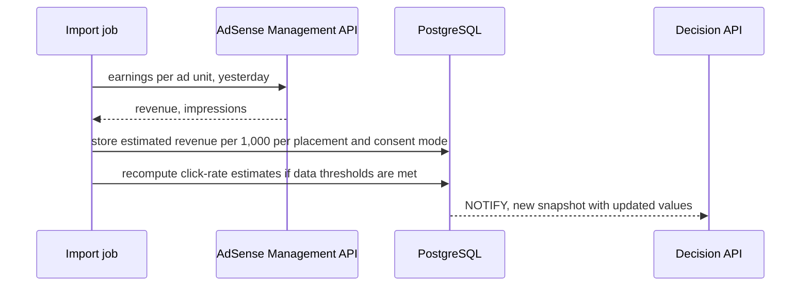
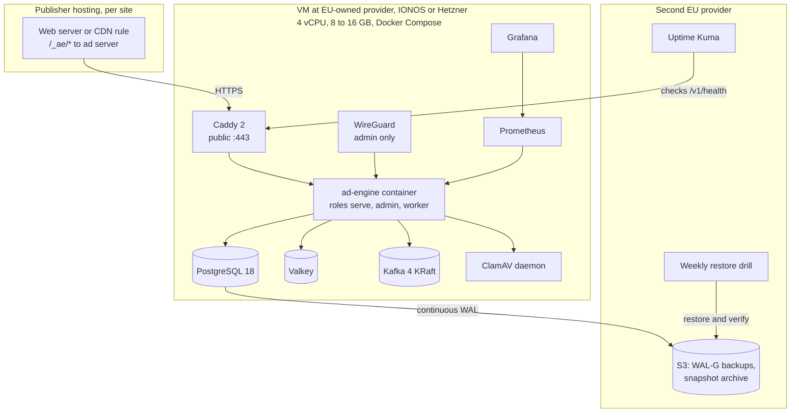

Last updated: 2026-11-13

# Ad Engine — Architecture

**Format.** This document follows the **arc42** template (12 sections). Diagrams use the **C4 model** (Context → Containers → Components, plus dynamic and deployment views), written in Mermaid so they live in the repo as text. Decisions are kept as ADRs in [docs/adr/](../adr/); requirements are in [../spec/requirements.md](../spec/requirements.md).

> Viewing the diagrams: GitHub renders Mermaid directly. In VS Code install the "Markdown Preview Mermaid Support" extension and open the Markdown preview.

---

## 1. Introduction and goals

Ad Engine decides, serves and counts ads on websites. It runs the founder's own sites now and is built so that external publishers can be added without a rewrite (ADR-34). Its public core is a portfolio piece.

**Top quality goals** (details in the spec, §4):

| Priority | Goal | Measured by |
|---|---|---|
| 1 | **Privacy by design**: no tracking without consent, still serve contextual ads | NFR-06, NFR-07 |
| 2 | **Never hurt the page**: fast, fail-open, no layout shift | NFR-04, NFR-05 |
| 3 | **Fast, explainable decisions** | NFR-01, DEC-09, DEC-12 |
| 4 | **Cheap to run for one person** | NFR-20, C-04 |
| 5 | **Tenant isolation**, so the product can be opened to others | TEN-05 |

## 2. Constraints

EU/CH-owned hosting on the ad path; AGPL core with only permissive libraries; Java 25 + Spring Boot 4; vanilla Postgres/Valkey/Kafka/S3; one maintainer. Full list: spec §2.2.

---

## 3. Context and scope — C4 level 1

Who and what the system talks to.

| Neighbour | What crosses the boundary |
|---|---|
| Publisher website | Tag script, decision requests/responses, click redirects |
| CMP | TC string, read by the tag via `__tcfapi` and sent with the decision request |
| Google AdSense | Engine tells the tag to render an AdSense unit; daily earnings import |
| Affiliate networks | Conversions per campaign (aggregated, no user data) |
| Prebid Server (later) | OpenRTB 2.6 requests with the TC string passed through |

---

## 4. Solution strategy

| Problem | Approach | ADR |
|---|---|---|
| Single-digit-ms decisions | Pure decision function over an immutable in-memory snapshot; counters in Valkey; no SQL on the request path | 16, 21 |
| Privacy law (TDDDG §25, GDPR) | Consent decided first; contextual mode stores nothing on the device; personal data minimised before it is written anywhere | 06, 07, 08 |
| One maintainer | **Modular monolith**: one deployable with three roles, not microservices. Infrastructure pieces are standard containers | 19, 26 |
| Future external users | `tenant_id` everywhere, users and roles, settings as data, isolation tests from M1 | 02, 34 |
| Future runtime swap (Rust etc.) | Hexagonal: the domain module has no framework dependencies | 19 |
| Unknown demand mix | Every demand source is behind one port, ranked by expected value | 11, 22 |

**Why not microservices.** Microservices pay off when several teams must deploy independently. Here one person maintains everything, the decision must finish in under 10 ms (network hops between services eat that), and each extra service adds monitoring, deployment and failure modes. The code is split into **modules with enforced boundaries** instead; if a part ever needs its own process, the `worker` role or the Prebid sidecar can be split off without changing code. The C4 diagrams below show this: several *containers* (processes and data stores), but only one is our own application.

---

## 5. Building blocks

### 5.1 C4 level 2 — Containers

A container is anything that runs or stores data: an application process, a database, a script in the browser.

`serve`, `admin` and `worker` are **one Docker image** started with different roles; on the launch server all three run in one JVM (`--roles=serve,admin,worker`).

### 5.2 C4 level 3 — Components inside the application

Hexagonal layout (ADR-19). Arrows point in the direction of dependency: adapters depend on ports, never the other way round.

### 5.3 Gradle modules

| Module | Contains | May depend on |
|---|---|---|
| `domain` | Model, `DecisionEngine`, policies | JDK only |
| `application` | Use cases, port interfaces | `domain` |
| `adapters/*` | One technology each | `application`, `domain`, its own library |
| `app` | Spring Boot main, wiring, roles | everything |
| `admin-ui` | React SPA; built by Gradle into the `app` image | generated OpenAPI client |
| `tag` | TypeScript tag | — |
| `kits/react`, `kits/wordpress` | Site integrations | `tag` |
| `simulator` | Traffic and pacing simulator | `domain`, `application` |
| `demo` | Synthetic tenant, compose profile | `app` |

### 5.4 Data model (core entities)

Events are not part of this model: they live in daily-partitioned, append-only tables with the flat ADR-14 schema (no foreign keys), ready to move to ClickHouse.

---

## 6. Runtime view — main workflows

These are C4 *dynamic* views drawn as sequence diagrams (the usual way to show a workflow across containers).

### 6.1 W1 — Page view → ad decision → render

### 6.2 W2 — Click and conversion

### 6.3 W3 — Event pipeline

### 6.4 W4 — Admin change → serving

### 6.5 W5 — Daily value update

---

## 7. Deployment view

| Environment | What runs | Where |
|---|---|---|
| Local / demo | Everything via `docker compose --profile demo up`, synthetic tenant + traffic | Laptop, CI |
| Production (launch) | The VM above | IONOS or Hetzner (EU) |
| Production (later) | 2+ app nodes behind a load balancer, managed or replicated Postgres, Valkey replica, Prometheus remote storage | Same provider, Kubernetes only at 3+ nodes (ADR-05) |

---

## 8. Cross-cutting concepts

| Concept | Rule |
|---|---|
| **Tenancy** | `tenant_id` on every row, event, Valkey key (`t:{tenant}:…`) and metric label; repositories cannot query without a tenant; isolation suite in CI |
| **Consent** | Decided first; mode flows through every step; stored on every event with its source |
| **Personal data** | Full IP in memory only; no IP/UA-derived IDs; no raw TC strings stored; retention by partition drop |
| **Money** | Integer micro-units + ISO 4217 currency; never floating point |
| **Time** | Stored in UTC; flights and dayparts interpreted in the site's time zone; `Clock` injected everywhere |
| **IDs** | UUIDv7 for entities and events (time-ordered, Postgres 18 `uuidv7()`) |
| **Errors** | RFC 9457 problem details on the admin API; the decision API never fails the page (`kind: none`) |
| **API versioning** | Path versions (`/v1`); events carry `schema_version` |
| **Security** | Session + TOTP, roles per tenant, CSRF on UI, signed click tokens, admin behind WireGuard, ClamAV on uploads, OWASP ZAP baseline in CI |
| **Observability** | Micrometer + OpenTelemetry; per-step latency histograms; rejection-reason counters; dashboards as code |
| **Testing** | Pyramid in ADR-28: unit + property-based, ArchUnit, Testcontainers, simulator, JMH, load, Playwright |

---

## 9. Architecture decisions

| Range | File |
|---|---|
| ADR-01 – ADR-16 (licence, tenancy, consent, privacy, demand, events, scale) | [docs/adr/](../adr/) |
| ADR-17 – ADR-35 (own-network scope, runtime, modules, delivery, value model, external readiness, analytics store) | [docs/adr/](../adr/) |

When the code repo exists, each ADR becomes one file in `docs/adr/` (Nygard format: context, decision, consequences).

---

## 10. Quality scenarios

| Scenario | Stimulus | Expected response |
|---|---|---|
| Visitor refuses tracking | TC string without purpose 1 | Contextual ad served; nothing stored on the device; event has `consent_mode=CONTEXTUAL` |
| Ad server down | Decision request times out | AdSense or static house ad within 800 ms; page layout unchanged |
| Traffic spike ×10 | 1,000 rps burst | p99 ≤ 10 ms on 2 nodes; no overspend beyond 2% |
| Trafficker pauses a flight | Click "pause" | Flight no longer served after ≤ 5 s |
| Second tenant added | New tenant with its own sites | No data from tenant 1 visible anywhere; isolation suite green |
| Disk lost | VM destroyed | Restored on a new VM from backups in ≤ 4 h, ≤ 15 min of data lost |

---

## 11. Risks and technical debt

| Risk | Mitigation |
|---|---|
| iabtcf-java is unmaintained (last commit Nov 2023) | Golden-string tests from the real CMP; fork if needed (ADR-07) |
| Contextual serving without consent is a legal grey zone | Per-site refusal policy switches to `NO_AD_ON_REFUSAL` without code change; lawyer ⚖️ |
| Single VM = single point of failure | Fail-open tag; tested restore; second node when traffic justifies it |
| Kafka is heavy for launch traffic | Behind `EventPublisherPort`; swap to a Postgres outbox if ops exceed ~2 h/month (ADR-14) |
| Low traffic makes learning noisy | Manual values first, thresholds before learning (ADR-32) |

---

## 12. Glossary

See spec §1.3. Additional: **C4** — Context, Containers, Components, Code diagram model. **arc42** — 12-section architecture documentation template. **ADR** — Architecture Decision Record. **CNAME** — DNS alias pointing a publisher subdomain at the ad server. **KRaft** — Kafka running without ZooKeeper.

---

## Appendix — Technology stack by container

| Container / area | Technology | Version (Nov 2026) | Licence |
|---|---|---|---|
| Language / runtime | Java, Generational ZGC | 25 LTS | GPLv2+CE (OpenJDK) |
| Application framework | Spring Boot (Web MVC on virtual threads, Security, Actuator, Validation) | 4.1.x (4.2 if GA) | Apache-2.0 |
| JSON | Jackson | 3.x (managed by Boot) | Apache-2.0 |
| SQL access / migrations | jOOQ OSS + Flyway | current | Apache-2.0 |
| Database | PostgreSQL | 18 | PostgreSQL |
| Counters, cache | Valkey + Lettuce client | 8.x/9.x | BSD-3 / Apache-2.0 |
| Event stream | Apache Kafka (KRaft) + Spring for Apache Kafka | 4.x | Apache-2.0 |
| Consent decoding | iabtcf-java (fork if needed) | 2.x | Apache-2.0 |
| Geo | DB-IP Lite (mmdb) + MaxMind DB reader library | monthly | CC BY 4.0 / Apache-2.0 |
| Device detection | uap-java + client hints | current | Apache-2.0 |
| Admin UI | React + TypeScript, Vite, Mantine, TanStack Query/Table, React Router, zod, i18next | React 19.x | MIT |
| Admin API client | openapi-typescript + openapi-fetch (generated from springdoc) | current | MIT |
| Analytics store (M5) | ClickHouse, self-hosted; clickhouse-java JDBC; clickhouse-backup | current | Apache-2.0 / MIT |
| API docs | springdoc-openapi (OpenAPI 3.1), AsyncAPI for events | current | Apache-2.0 |
| JS tag | TypeScript, esbuild | current | Apache-2.0 / MIT |
| React kit | TypeScript, React | 19.x | MIT |
| WordPress kit | PHP plugin | PHP 8.3+ | GPL-2.0+ (WordPress requires it; separate from core) |
| Malware scan | ClamAV daemon (separate process) | current | GPL-2.0 (not linked) |
| Reverse proxy / TLS | Caddy | 2.x | Apache-2.0 |
| Monitoring | Micrometer, OpenTelemetry, Prometheus, Grafana | current | Apache-2.0 / AGPL-3.0 (Grafana, separate process) |
| Uptime | Uptime Kuma | current | MIT |
| Backups | WAL-G to S3 | current | Apache-2.0 |
| Infrastructure as code | OpenTofu, Docker Compose, SOPS + age | current | MPL-2.0 / Apache-2.0 |
| Build / CI | Gradle (Kotlin DSL), GitHub Actions, Renovate, CycloneDX | Gradle 9.x | Apache-2.0 |
| Tests | JUnit, Mockito, AssertJ, Testcontainers, jqwik, ArchUnit, PIT, JMH, k6, Playwright, Lighthouse CI, OWASP ZAP | managed by Boot where possible | various permissive |
| Hosting | IONOS Cloud or Hetzner (primary), second EU provider for backups | — | — |
| Later | Prebid Server Java (sidecar), Kubernetes/Helm | — | Apache-2.0 |

GitHub (code hosting, CI) is US-owned but never sees visitor data, so it is outside the C-01 ad-path rule.
