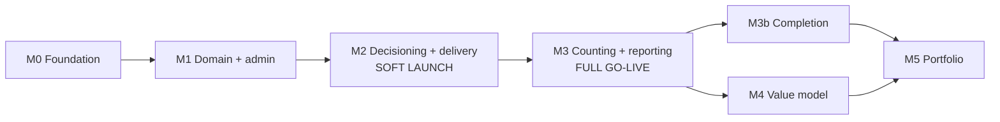

Last updated: 2026-11-17

# Ad Engine — Development roadmap

Task-level plan for building Ad Engine from an empty repo to "live on own sites" and "portfolio done".

- **What to build:** [spec/requirements.md](spec/requirements.md) (requirement IDs like `DEC-06`, `NFR-01`).
- **How it fits together:** [architecture/architecture.md](architecture/architecture.md).
- **Why:** ADR-01–35 in [adr/](adr/).

Each task below is sized to become **one GitHub issue / one pull request**.

---

## 1. Overview

| Milestone | Goal | Exit / demo | Ideal dev-days |
|---|---|---|---|
| **M0** Foundation | Empty repo → green CI, all modules, local stack | `docker compose up` + CI green | 7 |
| **M1** Domain + admin | Manage sites and campaigns through API and UI | Create a house campaign in the UI; isolation suite green | 21 |
| **M2** Decisioning + delivery | Serve ads consent-aware on a real site | **Soft launch:** house ads + AdSense fallback live on the first own site, no reporting yet | 27 |
| **M3** Counting + reporting | Count, pace, report | **Full go-live:** events, pacing, reports by consent mode | 16.5 |
| **M3b** Post-launch completion | Finish admin, kits, load test | Full admin UI, site kit, advertiser report link | 12 |
| **M4** Value model | Rank by real value; learn from data | EV ranking with imported values; simulator green | 13 |
| **M5** Portfolio | Evidence and polish | Demo profile, benchmarks, ClickHouse adapter, README | 13 |
| | | **Total** | **≈ 110** |

"Ideal dev-days" = focused days for one developer experienced in Java/Spring and React. Real calendar time is longer (§3).

---

## 2. Working agreements (apply to every task)

**Definition of done**
1. Code merged to `main` through a pull request with CI green: build, unit + integration tests, ArchUnit, licence report, SBOM, vulnerability scan, denylist, tag size check.
2. Tests at the right level: domain logic has unit or property tests; adapters have Testcontainers tests; UI flows that touch consent or rendering have Playwright tests.
3. OpenAPI spec (and AsyncAPI for events) updated if an interface changed; the generated TS client builds.
4. No personal data at rest: no full IP, raw TC string or IP/UA-derived ID (PRV-04–06).
5. Every new table, event, Valkey key and metric carries `tenant_id` (TEN-01). New endpoints are covered by the isolation suite (TEN-05).
6. If the task changes a decision, an ADR is added or updated in `docs/adr/`.

**Conventions**
- Issue title: `[M2-06] DecisionEngine v1`. Labels: milestone (`M2`), area (`dec`, `ui`, …), `go-live` if on the go-live path.
- Branches: `m2-06-decision-engine`. Commits: Conventional Commits (`feat(dec): …`).
- Estimates are ideal days. If a task exceeds its estimate by 50%, split it or flag it.
- **Areas:** `plat` platform/build, `dom` domain, `api` admin API, `ui` admin UI, `dec` decisioning, `cons` consent/privacy, `tag` JS tag and kits, `evt` events, `rep` reporting, `val` value model, `ops` infrastructure, `qa` testing/quality, `doc` docs.

---

## 3. Calendar estimates

Ideal days × 1.2 buffer, starting 18 Nov 2026. Holidays are not subtracted.

| Milestone end | 2 days/week | 3 days/week | Full time |
|---|---|---|---|
| M0 | mid-Dec 2026 | early Dec 2026 | end Nov 2026 |
| M1 | mid-Mar 2027 | early Feb 2027 | early Jan 2027 |
| M2 — **soft launch** | early Jul 2027 | late Apr 2027 | mid-Feb 2027 |
| M3 — **full go-live** | mid-Sep 2027 | early Jun 2027 | mid-Mar 2027 |
| M3b | early Nov 2027 | mid-Jul 2027 | early Apr 2027 |
| M4 | late Dec 2027 | mid-Aug 2027 | end Apr 2027 |
| M5 — **portfolio done** | Feb 2028 | late Sep 2027 | late May 2027 |

**Note.** An earlier plan put go-live at end of Feb 2027 on ~26–30 days. The agreed scope (React admin, tenant guardrails, explain mode, CNAME route, full consent sources) needs ~72 ideal days to full go-live. Feb 2027 is realistic only full time.

**To go faster without breaking the architecture** (pick any):
- **Two developers in parallel** (tracks in §5): roughly 35–40% shorter calendar time.
- **Swagger-first admin in M1**: build only login, campaigns/flights and creatives screens; manage sites/placements through Swagger UI until M3b. Saves ~3 days before soft launch.
- **Postgres outbox instead of Kafka at launch** (allowed by ADR-14): saves ~1 day of setup and the Kafka memory; Kafka adapter moves to M5.
- **Skip the CNAME route until an external publisher exists** (only needed by G6): saves ~1 day.

---

## 4. Tasks

Columns: **ID** · **Area** · **Task** · **Done when** · **Refs** (requirements / ADRs) · **Est** (ideal days) · **Needs** (task dependencies). ★ = on the critical path to soft launch.

### M0 — Foundation (7 days)

| ID | Area | Task | Done when | Refs | Est | Needs |
|---|---|---|---|---|---|---|
| M0-01 | plat | Create `adengine-core` (public) and `adengine-ops` (private) repos with `LICENSE` (AGPL-3.0), `CLA.md`, `SECURITY.md` stub, README stub, `.editorconfig`, issue/PR templates | Repos exist; templates used by the next PR | ADR-01, 17 | 0.5 | — |
| M0-02 ★ | plat | Gradle multi-module skeleton: Kotlin DSL, version catalog, Java 25 toolchain, modules `domain`, `application`, `adapters/*`, `app`, `admin-ui`, `tag`, `kits/*`, `simulator`, `demo` | `./gradlew build` passes on an empty skeleton | ADR-18, 19 | 1 | M0-01 |
| M0-03 | qa | ArchUnit rules: `domain` free of Spring/jOOQ/Jackson; no adapter→adapter imports; `application` depends only on `domain` | Rule violation in a test commit fails CI | NFR-16 | 0.5 | M0-02 |
| M0-04 ★ | plat | Spring Boot 4 app with roles `serve`/`admin`/`worker` (config flag), actuator health/info, JSON logging, Generational ZGC flags | `--roles=serve` starts only serve beans; `/actuator/health` UP | ADR-18, 19 | 0.5 | M0-02 |
| M0-05 ★ | plat | Docker Compose dev stack: Postgres 18, Valkey, Kafka 4 (KRaft), S3-compatible local store | `docker compose up` → all healthy; app connects | ADR-14, 18 | 0.5 | M0-04 |
| M0-06 ★ | plat | Flyway baseline (`tenant`, `site`) + jOOQ code generation from migrations via Testcontainers in the Gradle build | Generated classes compile; build reproducible without a local DB | ADR-18 | 1 | M0-05 |
| M0-07 | qa | CI (GitHub Actions): build, tests, ArchUnit, licence report (fails on non-permissive in core), CycloneDX SBOM, OSV scan, denylist of own domains/IDs; Renovate | All checks run on every PR | NFR-15, 21 | 1 | M0-02 |
| M0-08 | ui | `admin-ui` scaffold: Vite + React + TS + Mantine, pnpm; Gradle runs the build and copies `dist` into admin static resources; Vite dev proxy to Spring | `/admin/` serves the SPA from the Spring app; hot reload in dev | ADR-29 | 1 | M0-04 |
| M0-09 | tag | `tag` scaffold: TypeScript + esbuild single file; size-limit check (≤ 5 KB gzip) in CI | CI fails when tag exceeds budget | NFR-04 | 0.5 | M0-02 |
| M0-10 | doc | ADR-01–35 as one file each in `docs/adr/` (Nygard format) + index | Index links all ADRs | — | 0.5 | M0-01 |

### M1 — Domain, admin API, admin UI (21 days)

| ID | Area | Task | Done when | Refs | Est | Needs |
|---|---|---|---|---|---|---|
| M1-01 ★ | dom | Domain model: typed IDs (UUIDv7), `Money` (micros + currency), Tenant, Site, Placement, Advertiser, Campaign, Flight (targeting, goal, pacing, pricing, value per click, weight), Creative with sealed assets (`Display`, `Native`, `ThirdPartyTag`; `Video` reserved); invariants | Unit tests cover invariants (e.g. money currency mismatch, flight end before start) | CAM-01–05, ADR-15, 25 | 1.5 | M0-02 |
| M1-02 ★ | plat | Flyway schema for all config entities + `app_user`, `membership`, `audit_log`, `snapshot_version`; `tenant_id` on all; FKs and indexes | Migrations apply on empty DB; jOOQ regenerated | TEN-01, ADR-02 | 1.5 | M0-06, M1-01 |
| M1-03 ★ | plat | Persistence adapter (jOOQ): tenant-scoped repository base (no query compiles without `TenantId`), mappers to domain records | Testcontainers tests for CRUD per aggregate | TEN-01, 05 | 2 | M1-02 |
| M1-04 | api | Security: users, Argon2 password hashing, TOTP enrolment/verify, session cookie (HttpOnly, SameSite=Strict), CSRF for SPA, roles + tenant membership, lockout | Login + TOTP flow tested; role matrix tested per endpoint | TEN-03, 04, NFR-14 | 2.5 | M1-03 |
| M1-05 ★ | api | Admin REST v1: CRUD for sites, placements, URL rules, advertisers, campaigns, flights, creatives, flight–creative assignments; Bean Validation; compliance rules (payer required, political refused by default); RFC 9457 errors; OpenAPI 3.1 | OpenAPI published; API tests for each resource incl. validation errors | INV-01–02, 04, CAM-01–05, CPL-04, ADM-01 | 3 | M1-03, M1-04 |
| M1-06 | api | Append-only audit log written in the same transaction as every change | Every write in API tests produces an audit row; no update/delete path exists | CPL-06 | 0.5 | M1-05 |
| M1-07 | api | Creative assets: upload to S3, linter (format, size, HTTPS only, no auto-redirect, allow-listed trackers), approval status workflow | Bad uploads rejected with clear errors; approved creatives only become servable | CAM-06 | 1.5 | M1-05 |
| M1-08 | qa | Two-tenant isolation suite: tenant B cannot read, list, update or report on tenant A's data through any endpoint | Suite runs in CI; new endpoints fail CI if not covered | TEN-05, ADR-34 G1 | 1.5 | M1-05 |
| M1-09 | ui | Generate TS API client from OpenAPI in the build (`openapi-typescript` + `openapi-fetch`) | UI compiles against generated types; API change breaks UI build | ADM-03 | 0.5 | M0-08, M1-05 |
| M1-10 | ui | App shell: login + TOTP, layout, role-aware navigation, i18n (de/en), problem-details error display | Login works end to end; German and English switch | ADM-02 | 2 | M1-04, M1-09 |
| M1-11 | ui | Sites & placements screens incl. slot snippet generator (HTML, React, WordPress shortcode) | Create site + placement in UI; snippet copies | ADM-02, INV-01–02 | 1 | M1-10 |
| M1-12 | ui | Advertisers, campaigns, flights: forms incl. targeting (countries, device classes, categories, daypart), goal, pacing, pricing/value, weight | Full flight created in UI matches API validation | ADM-02, CAM-03 | 2.5 | M1-10 |
| M1-13 | ui | Creatives: upload, preview exactly as served (with label), approve/reject | Uploaded creative previewed and approved in UI | ADM-02, CAM-07 | 1 | M1-07, M1-10 |

### M2 — Decisioning, delivery, soft launch (27 days)

| ID | Area | Task | Done when | Refs | Est | Needs |
|---|---|---|---|---|---|---|
| M2-01 ★ | dec | Snapshot model + builder (jOOQ `multiset`), compiled bitset targeting index per placement | Builder test: 1,000 flights snapshot builds < 1 s; index returns correct candidates | DEC-04, ADR-21 | 2.5 | M1-03 |
| M2-02 ★ | dec | Snapshot refresh: version bump in the write transaction, `LISTEN/NOTIFY`, 5 s poll fallback, atomic swap; archive serialized snapshot to S3 (30 days) | Integration test: change visible to serving ≤ 5 s | DEC-11, NFR-03 | 1.5 | M2-01 |
| M2-03 ★ | cons | `ConsentPort` + iabtcf-java adapter; sources `TCF_PUBLISHER_PURPOSES`, `CMP_CUSTOM_VENDOR`, `TCF_VENDOR`, `NOT_APPLICABLE`; country policy table; golden TC strings from the chosen CMP | All golden strings decode to expected mode; each source tested | DEC-02, PRV-01–03, ADR-20 | 3 | M1-03, F-01 |
| M2-04 | dec | Geo (DB-IP Lite, monthly refresh job) and device (uap-java + client hints) adapters; IP truncation utility; privacy guard test | Guard test fails if a full IP reaches any persisted structure | PRV-04, 05, NFR-07 | 1 | M0-04 |
| M2-05 | dec | `ContextPort` rules adapter (site categories + URL rules) with Valkey cache; miss never blocks, queues URL | Miss returns site defaults in < 1 ms | DEC-03, ADR-09 | 1 | M1-03 |
| M2-06 ★ | dec | `DecisionEngine` v1 (pure): consent mode → candidates → policy filters (approval, categories per country, minor context, political, personalisation) → dates → tier + weight ranking → explain reasons. Injected `Clock`/`RandomSource` | jqwik invariants pass (filtered never wins, tier order, label present); determinism test (DEC-12) | DEC-02, 04, 05, 07, 12, CPL-03, 05 | 4 | M2-01, M2-03 |
| M2-07 ★ | dec | Decision API `POST /v1/decisions`: tenant by `Host`, multi-slot, page-view ID issued, markup rendering (label, info link, `rel="sponsored noopener"`), signed click URL creation, `kind` markup/fallback/none | Contract tests match spec §5.1; unknown host → 404 without leaking tenants | DEC-01, 08, TEN-02, CPL-01, 02 | 2.5 | M2-06 |
| M2-08 ★ | tag | JS tag: slot discovery, reserved size, `__tcfapi` wait + timeout, request, render; fallback chain (unmodified AdSense if Google consented → static house → collapse); SPA API `refresh`/`newPageView`/`setConsent`; lazy fill | Tag ≤ 5 KB gzip; unit tests for fallback logic | DEL-01–08 | 3 | M2-07 |
| M2-09 | ops | Delivery routes: Caddy on-demand TLS for `ads.<domain>` (ask-endpoint allows only known site domains); proxy snippets for nginx, Next.js `rewrites`, Caddy | Both routes work in the demo stack | DEL-04, ADR-23, 34 G6 | 1 | M2-07 |
| M2-10 | dec | `ads.txt` endpoint per site from tenant data | Correct lines for the demo tenant incl. Google line | INV-03 | 0.5 | M1-05 |
| M2-11 | dec | Explain mode on the decision API (admin session or token only) | Returns all candidates with reasons; anonymous call ignores `explain` | DEC-09 | 0.5 | M2-07 |
| M2-12 | qa | Demo pages (plain HTML + small React app) + Playwright: no storage/device read before consent; fallback with ad server stopped; zero CLS; SPA route change refreshes slots | All four tests green in CI | NFR-04–06, 19, DEL-01 | 3 | M2-08 |
| M2-13 ★ | ops | Infrastructure: OpenTofu for VM + second-provider S3; production Compose; Caddy; WireGuard for admin; SOPS secrets; one-command deploy | Fresh VM deployed from scratch by script; admin unreachable from the internet | OPS-01, NFR-13, ADR-26 | 2 | M0-05, F-03 |
| M2-14 ★ | ops | Backups: WAL-G continuous to second provider; weekly automated restore drill with alert; Uptime Kuma check on decision endpoint | Drill restores and verifies; failure alerts | OPS-02, 04, NFR-12 | 1.5 | M2-13 |
| **Exit** | | **Soft launch** on the first own site: house ads + AdSense fallback, consent branch live | Live for 7 days without page impact | | | F-01–F-06 |

### M3 — Counting, pacing, reporting → full go-live (16.5 days)

| ID | Area | Task | Done when | Refs | Est | Needs |
|---|---|---|---|---|---|---|
| M3-01 ★ | evt | Event schema v1 (+ AsyncAPI doc), `EventPublisherPort` Kafka adapter (async, batched); impression-at-delivery and no-fill events from the decision path | Events on topic with `schema_version`, consent mode/source, no full IP | EVT-01, 03, ADR-14 | 1.5 | M2-07 |
| M3-02 | evt | Click redirect `/c/{token}`: verify HMAC + expiry, 302 with campaign tracking parameter, 410 when invalid, click event | Tampered/expired token → 410; no open redirect possible | EVT-02 | 1 | M3-01 |
| M3-03 ★ | evt | Worker: Kafka consumer → daily Postgres partitions (creation job), dedup on `event_id`; behind `EventStorePort` | Replayed batch produces no duplicates | EVT-04, REP-06 | 2 | M3-01 |
| M3-04 ★ | dec | Counters in Valkey (Lua check-and-reserve): goals, budgets, share of voice; even pacing on a flat curve; frequency caps branched on consent (first-party ID only with consent, per page view otherwise) | Concurrency test: two nodes cannot overspend; caps never use an ID without consent | DEC-06, PRV-07, ADR-08, 24 | 3 | M2-06 |
| M3-05 ★ | dec | Eligibility step with one pipelined counter read; per-page caps; max one ad per advertiser per page view | Latency budget for counters ≤ 2 ms in integration test | DEC-06 | 1.5 | M3-04 |
| M3-06 | evt | Bot traffic (GIVT): open bot UA list + flag-and-exclude from billable counts | Known crawler requests flagged; excluded in reports | EVT-05 | 1 | M3-01 |
| M3-07 ★ | rep | Pre-summed tables hourly/daily (additive values only), retention job dropping partitions per policy, `ReportQueryPort` | Retention test drops old partitions; sums match raw events | PRV-08, REP-06, ADR-35 | 2 | M3-03 |
| M3-08 ★ | rep | Reports API + UI essentials: dashboard (today, 7 days), consented vs non-consented view, CSV export, k ≥ 10 suppression | Numbers match raw events on demo data | REP-01–02, PRV-10 | 2 | M3-07, M1-10 |
| M3-09 | val | Manual values (value per click per flight, AdSense RPM per site) + EV ranking incl. AdSense fallback as candidate + strategic weight | House ad loses to AdSense when EV lower; weight flips it as configured | VAL-01, DEC-07, ADR-22, 32 | 1 | M3-05 |
| M3-10 | ops | Observability: Micrometer metrics, per-step latency histograms, rejection-reason counters, Grafana dashboards + alerts as code | Dashboards load from repo; alert fires in a test | OPS-03, ADR-27 | 1.5 | M3-01 |
| **Exit** | | **Full go-live**: counting, pacing, reports by consent mode on the first own site | 30-day availability clock starts | | | |

### M3b — Post-launch completion (12 days)

| ID | Area | Task | Done when | Refs | Est | Needs |
|---|---|---|---|---|---|---|
| M3b-01 | ui | Full reports: pivot by all REP-01 dimensions, saved views | Any dimension combination exports to CSV | REP-01 | 1.5 | M3-08 |
| M3b-02 | rep | Advertiser report: signed expiring link + read-only SPA route | Link shows one advertiser only; expired link refused | REP-03 | 1 | M3-08 |
| M3b-03 | ui | Explain screen: paste URL + TC string, see candidates and reasons | Matches API explain output | DEC-09 | 1 | M2-11 |
| M3b-04 | ui | Users & roles, audit log view, settings (consent source/policy, country table, AdSense link) | Role change takes effect immediately | ADM-02, TEN-03 | 2 | M1-10 |
| M3b-05 | api | ClamAV daemon scan on upload (required before any external user uploads) | EICAR test file rejected | CAM-06 | 1 | M1-07 |
| M3b-06 | api | Tenant export/delete; usage metrics per tenant | Demo tenant exported and deleted; other tenant untouched | TEN-06, 07 | 1 | M3-07 |
| M3b-07 | tag | Site kit for the first site's stack: `@adengine/react` (`<AdSlot/>`, route hook) **or** WordPress plugin (block, shortcode, settings, ads.txt) | Used on the live site | DEL-09 | 2 | M2-08, F-02 |
| M3b-08 | qa | Load test (k6): 300 rps sustained, p99 ≤ 10 ms server-side on 4 vCPU | Report committed to `docs/benchmarks/` | NFR-01 | 1 | M3-05 |
| M3b-09 | ui | Flight delivery view (goal, delivered, pacing curve, forecast) + lost-fill view | Values match counters and reports | REP-04, 05 | 1.5 | M3-08 |

### M4 — Value model (13 days)

| ID | Area | Task | Done when | Refs | Est | Needs |
|---|---|---|---|---|---|---|
| M4-01 | val | AdSense Management API import: daily earnings per ad unit → RPM per placement | Import idempotent; values appear in snapshot | VAL-02 | 2 | M3-09, F-04 |
| M4-02 | val | Conversions: Digistore24 IPN webhook (shared secret) + Amazon PartnerNet CSV import; value per click per campaign | Aggregated per campaign/day; no user data stored | EVT-07, VAL-03 | 2 | M3-02, F-05 |
| M4-03 | val | Learning stages (manual → pooled → per creative) with config thresholds; Beta–Bernoulli click rates; Thompson sampling via `RandomSource`; tenant-scoped | Seeded test reproduces choices; no cross-tenant pooling | VAL-04, ADR-22, 32 | 2.5 | M3-09 |
| M4-04 | dec | Pacing: hour-of-week traffic curve per placement + proportional correction every 5 min | Simulator shows overspend ≤ 2% | ADR-24, NFR-09 | 1.5 | M3-04 |
| M4-05 | qa | `simulator` module: replays traffic curves through the real engine with fake clock; CI checks overspend and share of voice | CI fails when targets missed | NFR-09 | 2 | M4-04 |
| M4-06 | dec | Decision sampling log (no personal data) + replay CLI against archived snapshots | Replay of yesterday's sample reproduces decisions | DEC-10 | 2 | M2-02 |
| M4-07 | val | Holdout / experiment arms (per page view), off until ≥ 5k PV/day | Arm on every event; switch is config only | VAL-05 | 1 | M3-01 |

### M5 — Portfolio (13 days)

| ID | Area | Task | Done when | Refs | Est | Needs |
|---|---|---|---|---|---|---|
| M5-01 | qa | Demo profile: synthetic tenant seeder (3 sites, house/direct/mock AdSense) + traffic generator | `docker compose --profile demo up` → live dashboard ≤ 5 min | OPS-05, NFR-18 | 2 | M3-10 |
| M5-02 | qa | JMH benchmarks, PIT mutation and coverage gates, Lighthouse CI, OWASP ZAP baseline in CI | Gates enforced; numbers in README | NFR-02, 14, 17 | 2 | M2-06 |
| M5-03 | rep | ClickHouse adapter: Kafka engine table, materialized-view summaries, TTL retention, report adapter (`JdbcClient`), clickhouse-backup; in demo profile | Same report results as Postgres on demo data | REP-07, ADR-35 | 5 | M3-07 |
| M5-04 | qa | Second load test: 1,000 rps burst on 2 nodes | Report committed | ADR-16 | 1 | M3b-08 |
| M5-05 | cons | Data subject export/delete by frequency ID | Audit trail of each request | PRV-09 | 1 | M3-04 |
| M5-06 | doc | README (C4 diagrams, how to run, trade-offs), ADR index, write-up of consented vs non-consented results | Reviewed by someone outside the project | — | 2 | all |

### Owner track (non-development, blocks marked tasks)

These are tasks for the site owner, not development tasks, so they are not GitHub issues.

| ID | Task | Needed by |
|---|---|---|
| F-01 | Choose the CMP with the ADR-33 checklist; capture 10–20 real TC strings (incl. publisher segment) as golden fixtures | M2-03 |
| F-02 | Decide the first live site and its stack | M2 exit, M3b-07 |
| F-03 | Open accounts: primary provider (IONOS or Hetzner) + second EU provider for backups; DNS access for each site | M2-13 |
| F-04 | AdSense: site approval, one ad unit per placement, ads.txt line, Management API OAuth client | M2 exit, M4-01 |
| F-05 | Affiliate accounts and campaign tracking keys (Digistore24, Amazon PartnerNet); first house creatives | M2 exit, M4-02 |
| F-06 | Privacy policy and Impressum texts covering Ad Engine and AdSense ⚖️; optional lawyer question on contextual serving with publisher purposes | M2 exit |

---

## 5. Parallel tracks (for more than one developer)

| Track | Owns | Can start when |
|---|---|---|
| **Core backend** | `dom`, `dec`, `cons`, `evt`, `val` | M0-02 |
| **Admin & API** | `api`, `ui`, `rep` UI parts | M1-03 (API), M1-09 (UI) |
| **Edge & ops** | `tag`, kits, `ops`, Playwright | M0-05 (ops), M2-07 (tag; mock the API from the spec earlier) |

Interfaces between tracks are the OpenAPI spec, the decision API contract (spec §5.1) and the event schema (AsyncAPI). Agree on them before coding against them.
